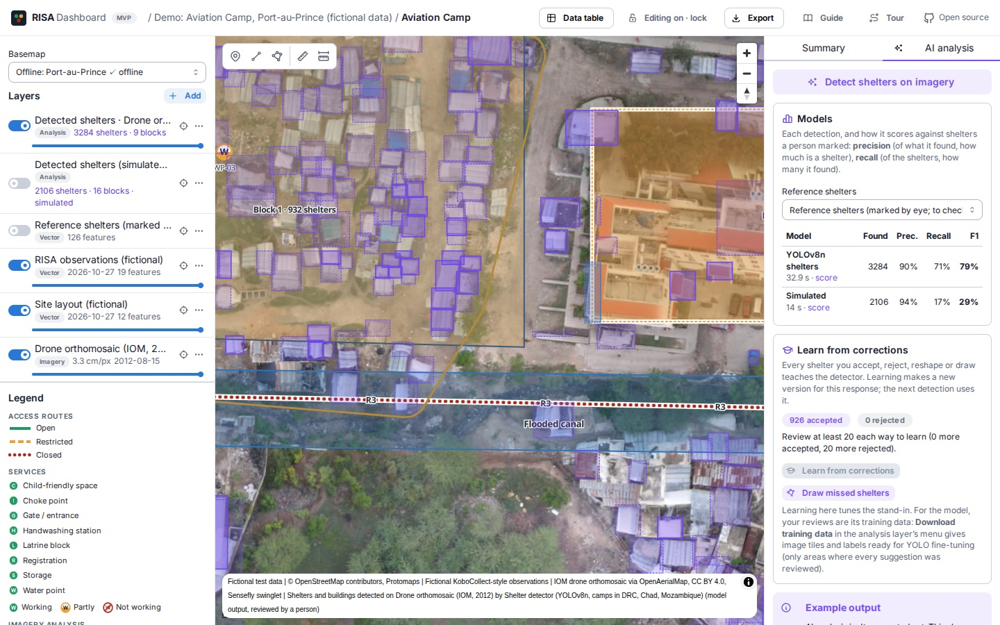
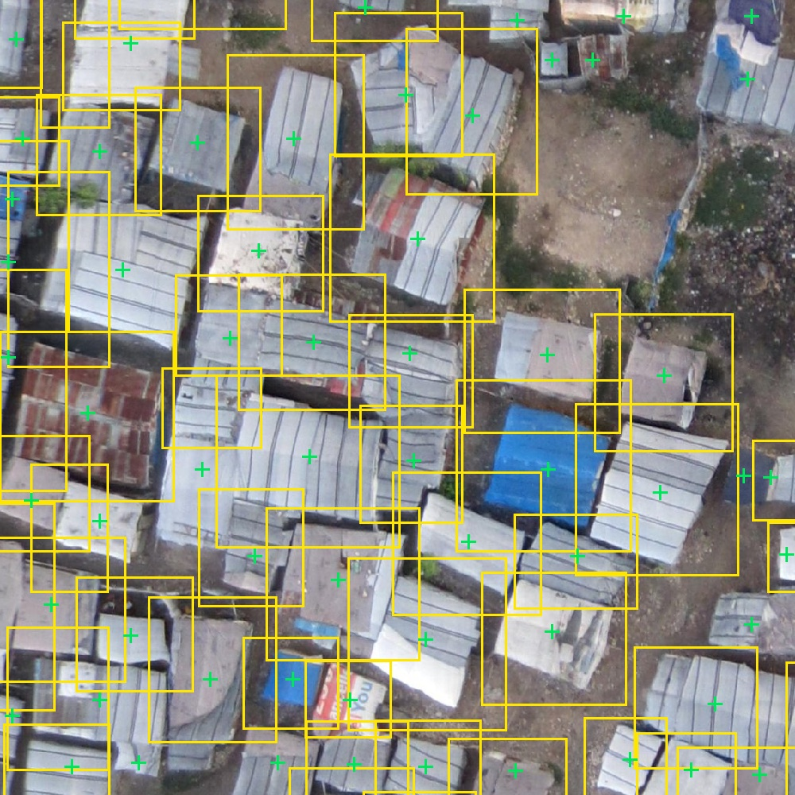
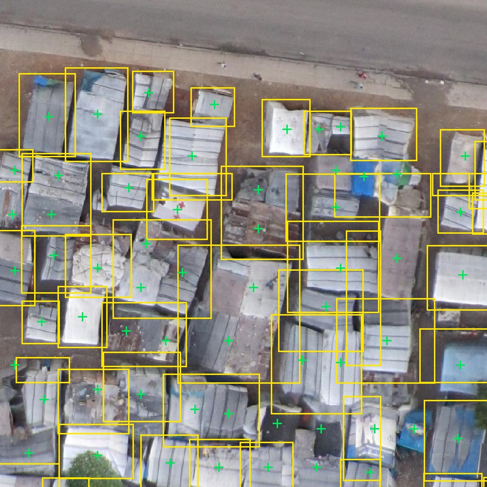
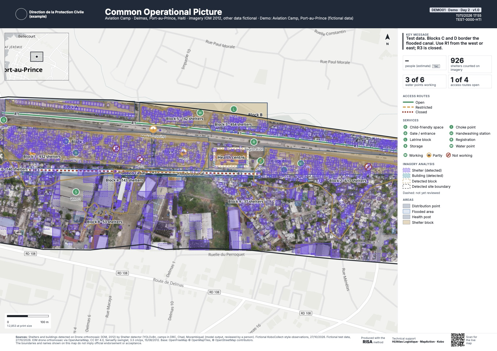

# Counting shelters from drone imagery in the first days of a response

**A research partnership on the RISA Dashboard's imagery analysis**

Brief for prospective AI research partners · RISA consortium (HI/Atlas Logistique, MapAction, Kobo) · November 2026 · technical detail in [`models.md`](models.md)

---

## The problem

In the first days after an earthquake, flood or cyclone, coordinators need to know, for each displacement site, how many people are there, whether they can be reached, and which services still work. RISA (Rapid Infrastructure and Service Assessment) answers with drone imagery, direct observation recorded in KoboCollect, and GIS, printed as one page people can brief from in a minute.

The number everything else hangs on, how many shelters (and so how many people), still comes from a person digitising roofs on an orthomosaic: hours per site, in the days when every hour counts. Off-the-shelf building models don't fit: displacement sites are tents, tarps and sheet metal, packed tight, different in every context, and imaged at 2–10 cm from a drone rather than 50 cm from a satellite.

## What exists today

The **RISA Dashboard** is a working, open-source tool (AGPL-3.0), running for testing at **https://risa-dash.kobolabs.dev/r/demo** (a demo on IOM's 2012 imagery of Aviation Camp, Port-au-Prince; everything but the imagery is fictional). The same software runs self-hosted by a national authority, and fully offline on a field kit.

Imagery analysis is built in, with a person in the loop:

1. A responder uploads the orthomosaic and presses **Detect shelters**. A detector finds shelters and buildings; the dashboard groups shelters into blocks and outlines the site.
2. Everything comes back as a **suggestion**, dashed on the map, with its confidence. Reviewers accept, reject, reshape or re-tag, one by one or in bulk by confidence, and draw what was missed.
3. Only **accepted** shelters count on the printed product. Every review is kept as a **label**.
4. **Download training data** turns the reviewed areas into a ready-to-train dataset (image tiles with YOLO labels, plus polygons and hard negatives).
5. The **Models** card scores each detector against reference shelters, side by side.

The detector is a plug-in: a model turns pixels into scored polygons, and the dashboard does the rest (tiling, storage, review, blocks, figures, print, exports, evaluation). Two are in today: a colour-rule stand-in, used to build the workflow, and a **real baseline**, an open YOLOv8n model fine-tuned by Alexis ([alex6H](https://github.com/alex6H/RefugeeCampShelterDetection-YOLOv8), MIT licence) on drone imagery of camps in DRC, Chad and Mozambique, running on CPU: about half a minute for a 0.5 km² site on a laptop, a few minutes on the hosted instance's small worker.

## First results

On three areas of about 37 × 37 m of the Haiti image, shelters marked as points (indicative: marked by eye by an AI assistant, not yet checked by a person; 99 shelters):

| | Precision | Recall | F1 |
|---|---|---|---|
| Colour-rule stand-in | 0.94 | 0.17 | 0.29 |
| **Shelter model (YOLOv8n), off the shelf** | **0.90** | **0.71** | **0.79** |

Where shelters stand apart it finds four in five (F1 0.86); where sheet-metal roofs run together it finds three in five (F1 0.75); on open ground, one low-confidence false alarm.

| Shelters standing apart | Dense, roofs running together |
|---|---|
|  |  |

*Yellow: the model's detections. Green: shelters marked as reference. A cross with no box is a missed shelter.*

A model trained on plastic-sheeting shelters in DRC transfers to Haitian sheet-metal shelters with high precision but misses about three in ten, mostly in dense blocks. That gap is what fine-tuning on reviewed labels from the context is for, and the dashboard already produces those labels as people work.

## What we'd do together

In order of what would change practice soonest:

1. **A benchmark people trust.** Person-checked outlines of every shelter in reference areas from several contexts and seasons (Haiti, Venezuela's stadium camp, Mozambique resettlement sites, Cox's Bazar), with a fixed test split and the dashboard's evaluation (precision, recall, count error, and the share of confident detections that are wrong).
2. **Outlines, not boxes.** A segmenter, or SAM 2 prompted with the detector's boxes, so footprints and their areas are right.
3. **Fine-tuning from reviews.** A training service that takes a response's reviewed tiles, fine-tunes on a GPU, evaluates on the fixed split, and registers a new version only if it beats the last, per site and overall, with a model card for each.
4. **Active learning.** Reviewers see the suggestions the model is least sure of first, so each review teaches it most.
5. **More classes.** Latrines, water points, standing water, debris, paths: things to check against the KoboCollect observations, and the next figures on page 1.

## The constraints that make it interesting

- **Runs where the data must stay.** On a national authority's server, often without a GPU, or fully offline on a field kit. CPU inference in minutes per site is the bar; ONNX or small PyTorch models; weights that can be redistributed inside an AGPL tool by governments and NGOs (no non-commercial or research-only licences).
- **People decide.** Suggestions are never counted until accepted; confidence and the model are kept on every feature and in every export; a model's confident mistakes are measured, because they're the ones reviewers miss.
- **Sensitive imagery.** Displacement sites are where vulnerable people live. Labels and imagery are pooled for training only with the data owner's agreement; the default is a model per response, trained where the data is.
- **Every context is new.** The test of a method is how fast it adapts to the next emergency from a few hundred reviews, not its score on one dataset.

## What we bring, what we'd ask

We bring a working, open tool in responders' hands, the review workflow that turns their work into labels, the consortium's field access and imagery (MapAction, HI/Atlas Logistique), and deployment from the cloud to offline kits (Kobo). We'd ask for modelling expertise, GPU time for fine-tuning and evaluation, and help building the benchmark. Everything built would be open source, and the models open-weight under a licence that lets authorities run them themselves.
